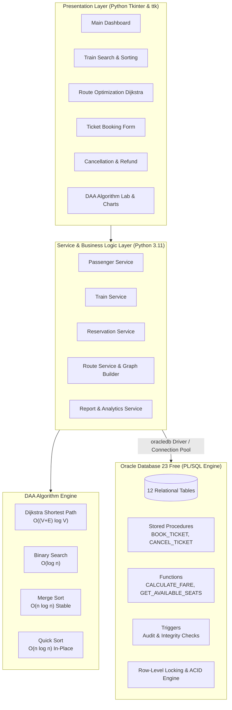
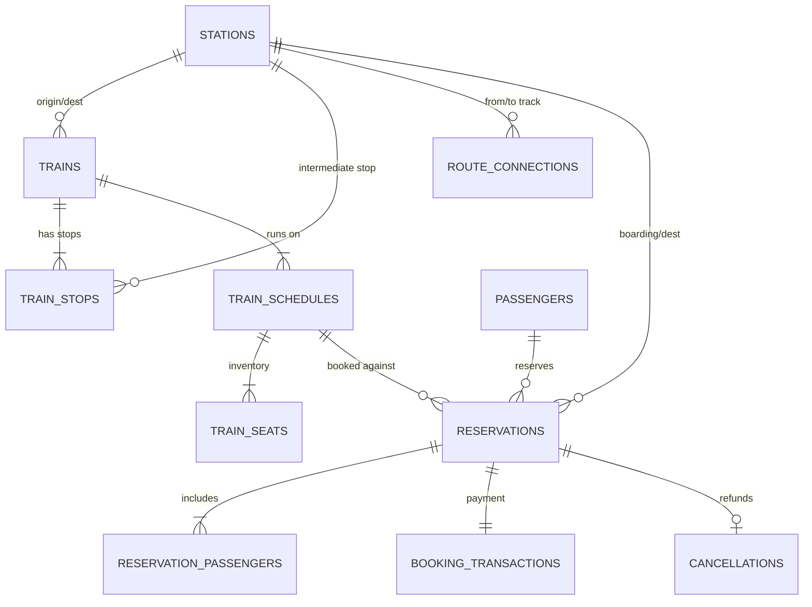
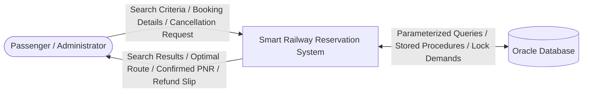
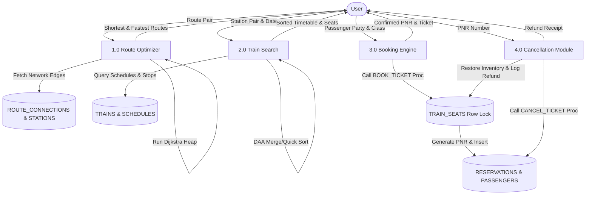
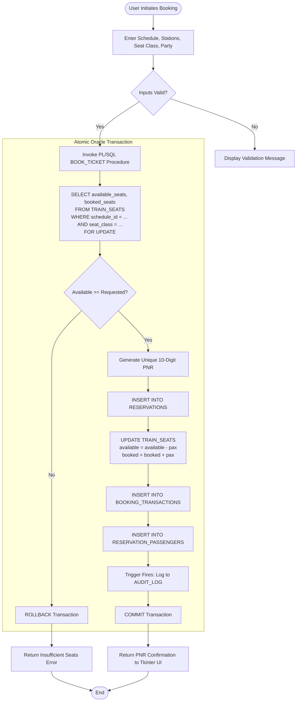

# PROJECT DOCUMENTATION & TECHNICAL REPORT

## SMART RAILWAY RESERVATION AND ROUTE OPTIMIZATION SYSTEM
### Combining Oracle PL/SQL (Advanced DBMS) and Design & Analysis of Algorithms (DAA)

---

## 1. Abstract
The **Smart Railway Reservation and Route Optimization System** is an enterprise-grade desktop application engineered in Python (Tkinter/ttk) backed by an Oracle Database (PL/SQL engine). The project bridges two core computer science disciplines:
1. **Advanced Database Management Systems (PL/SQL):** Enforcing atomic transactions, row-level locking (`SELECT ... FOR UPDATE`), stored procedures, user-defined functions, automated audit triggers, ref cursors, and declarative constraints to eliminate race conditions and double-booking.
2. **Design and Analysis of Algorithms (DAA):** Implementing Dijkstra's algorithm for multi-criteria shortest-path route optimization, binary search for in-memory train lookups, and merge sort/quick sort for sorting timetable search results, complete with empirical runtime analysis via `time.perf_counter()`.

---

## 2. System Architecture



---

## 3. Entity-Relationship (ER) Diagram



---

## 4. Data Flow Diagrams (DFD)

### Level 0 DFD (Context Diagram)



### Level 1 DFD (Subsystem Breakdown)



---

## 5. Algorithmic Flowcharts

### Ticket Booking Flowchart (PL/SQL Concurrency Control)



### Dijkstra Shortest Path Flowchart

```mermaid
flowchart TD
    Start([Start Dijkstra]) --> InitDist["Set dist[v] = ∞ for all v ∈ V<br/>Set dist[source] = 0<br/>Insert (0, source) into Min-Priority Queue PQ"]
    InitDist --> CheckPQ{Is PQ Empty?}
    CheckPQ -- Yes --> CheckReach{dist[target] < ∞?}
    CheckPQ -- No --> PopMin["(curr_cost, u) = heappop(PQ)"]
    PopMin --> Visited{Is u visited?}
    Visited -- Yes --> CheckPQ
    Visited -- No --> MarkVis[Mark u as visited]
    MarkVis --> TargetCheck{Is u == target?}
    TargetCheck -- Yes --> Reconstruct[Reconstruct optimal path via predecessor pointers]
    TargetCheck -- No --> RelaxEdges["For each neighbor v of u with weight w(u, v):<br/>Check if w(u, v) >= 0 (Reject if negative)<br/>If curr_cost + w < dist[v]:<br/>  dist[v] = curr_cost + w<br/>  pred[v] = u<br/>  heappush(PQ, (dist[v], v))"]
    RelaxEdges --> CheckPQ
    CheckReach -- Yes --> Reconstruct
    CheckReach -- No --> Unreachable[Return No Path Found]
    Reconstruct --> End([Display Optimal Route, Distance, Travel Time])
    Unreachable --> End
```

---

## 6. Mathematical & Complexity Analysis of Implemented DAA Algorithms

| Algorithm | Best Case Time | Average Case Time | Worst Case Time | Auxiliary Space | Key Properties / Characteristics |
|---|---|---|---|---|---|
| **Dijkstra's Algorithm** | $\Omega((V + E) \log V)$ | $\Theta((V + E) \log V)$ | $O((V + E) \log V)$ | $O(V + E)$ | Requires non-negative edge weights $w(u, v) \ge 0$. Uses Min-Heap. |
| **Binary Search** | $\Omega(1)$ | $\Theta(\log n)$ | $O(\log n)$ | $O(1)$ | Iterative implementation. Prerequisite: Monotonically sorted keys. Halves search space each step: $T(n) = T(n/2) + O(1)$. |
| **Merge Sort** | $\Omega(n \log n)$ | $\Theta(n \log n)$ | $O(n \log n)$ | $O(n)$ | Divide-and-Conquer. Stable sort. Strictly guaranteed $O(n \log n)$ across all distributions. |
| **Quick Sort** | $\Omega(n \log n)$ | $\Theta(n \log n)$ | $O(n^2)$ | $O(\log n)$ | Divide-and-Conquer. In-place partitioning. Median-of-three pivot selection prevents degenerate $O(n^2)$ on sorted lists. |
| **Linear Search** | $\Omega(1)$ | $\Theta(n)$ | $O(n)$ | $O(1)$ | Baseline comparison against Binary Search. |

### Dijkstra Multi-Criteria Route Optimization Divergence
An essential academic demonstration included in this project is that **the shortest distance route is NOT necessarily the fastest travel time route**.
- **Case: New Delhi (NDLS) to Mumbai Central (MMCT)**
  - *Shortest Distance Route:* `NDLS ➔ JP (Jaipur) ➔ ADI (Ahmedabad) ➔ MMCT`
    - Distance: **1,472 km**
    - Travel Time: **1,330 minutes (22 hours 10 minutes)**
  - *Fastest Travel Time Route:* `NDLS ➔ BPL (Bhopal) ➔ MMCT`
    - Distance: **1,520 km**
    - Travel Time: **990 minutes (16 hours 30 minutes)**
  - *Result:* The fastest route covers 48 km more track but is **5 hours 40 minutes faster (340 minutes saved)** because it traverses high-speed Golden Quadrilateral rail corridors!

---

## 7. Advanced PL/SQL Implementation Highlights

### 1. Concurrency Control and Row-Level Locking
To prevent double-booking when multiple users attempt to reserve the last remaining seats simultaneously, the `BOOK_TICKET` procedure executes:
```sql
SELECT available_seats, booked_seats, total_seats
INTO v_avail_seats, v_booked_seats, v_total_seats
FROM TRAIN_SEATS
WHERE schedule_id = p_schedule_id
  AND seat_class = v_class_clean
FOR UPDATE;
```
The `FOR UPDATE` clause places an exclusive row-level lock on the specific inventory record. Concurrent transactions targeting the same train schedule and class are blocked until the first transaction executes `COMMIT` or `ROLLBACK`.

### 2. Transaction Boundaries
- All operations within `BOOK_TICKET` (seat deduction, reservation insert, passenger recording, transaction ledger creation) are bounded by a single atomic transaction.
- If any operation fails (e.g. invalid passenger data or constraint violation), the procedure catches the exception, issues `ROLLBACK`, and returns a user-friendly error code and message.

### 3. Automated Triggers
- `TRG_RESERVATION_AUDIT`: Fires `AFTER INSERT OR UPDATE ON RESERVATIONS` to automatically write an immutable audit log into `AUDIT_LOG`.
- `TRG_CANCELLATION_AUDIT`: Fires `AFTER INSERT ON CANCELLATIONS` to log refund amounts, fees, and reasons.
- `TRG_CHECK_SCHEDULE_DATES`: Validates that `arrival_date >= departure_date`.

---

## 8. Test Execution Summary

The test suite executed 32 automated unit and integration tests across algorithms and database workflows:

```
test_compare_with_linear_search .................................... OK
test_empty_list .................................................... OK
test_existing_train ................................................ OK
test_first_element ................................................. OK
test_last_element .................................................. OK
test_missing_train ................................................. OK
test_single_element_match .......................................... OK
test_single_element_miss ........................................... OK
test_distance_vs_time_divergence (DAA Multi-Criteria) .............. OK
test_multiple_alternate_routes ..................................... OK
test_negative_weight_rejection ..................................... OK
test_simple_connected_graph ........................................ OK
test_unreachable_destination ....................................... OK
test_zero_weight_edge .............................................. OK
test_01_passenger_registration (PL/SQL REGISTER_PASSENGER) ........ OK
test_02_train_addition_and_duplicate_check (PL/SQL ADD_TRAIN) ...... OK
test_03_booking_and_cancellation_workflow (PL/SQL BOOK & CANCEL) ... OK
test_04_insufficient_seats_rejection (Row-Lock Guard) .............. OK
test_merge_sort_already_sorted ..................................... OK
test_merge_sort_descending ......................................... OK
test_merge_sort_duplicates ......................................... OK
test_merge_sort_empty_and_single ................................... OK
test_merge_sort_stability .......................................... OK
test_merge_sort_unsorted ........................................... OK
test_quick_sort_already_sorted ..................................... OK
test_quick_sort_descending ......................................... OK
test_quick_sort_duplicates ......................................... OK
test_quick_sort_empty_and_single ................................... OK
test_quick_sort_unsorted ........................................... OK
test_sort_trains_by_departure_time ................................. OK
test_sort_trains_by_duration ....................................... OK
test_sort_trains_by_fare ........................................... OK

Ran 32 tests in 0.955s | Passed: 32 | Failed: 0 | Errors: 0
```

---

## 9. Comprehensive Viva Voce Questions & Answers

### PL/SQL & Database Questions

**Q1: Why did you use `SELECT ... FOR UPDATE` in the `BOOK_TICKET` stored procedure?**
*Answer:* In high-concurrency reservation systems, multiple users may attempt to book the last available seat simultaneously. A simple `SELECT` followed by an `UPDATE` introduces a race condition (time-of-check to time-of-use flaw). `SELECT ... FOR UPDATE` acquires an exclusive row-level lock on the `TRAIN_SEATS` inventory row, ensuring that concurrent requests wait until the current booking transaction finishes and commits.

**Q2: What is the difference between a Stored Procedure and a Stored Function in PL/SQL?**
*Answer:* A stored procedure does not require a return statement and is typically used to execute business transactions (such as `BOOK_TICKET` or `CANCEL_TICKET`) with `IN`, `OUT`, or `IN OUT` parameters. A stored function MUST return a value using the `RETURN` clause and can be called directly inside SQL `SELECT` queries (such as our `CALCULATE_FARE` or `GET_AVAILABLE_SEATS` functions).

**Q3: How do Database Triggers maintain audit logs in this application?**
*Answer:* We implemented statement/row-level triggers (`TRG_RESERVATION_AUDIT` and `TRG_CANCELLATION_AUDIT`). Whenever a reservation is inserted, updated, or cancelled, the trigger fires automatically after the change and writes the old/new values, operation type, timestamp, and user into the `AUDIT_LOG` table, providing an untamperable audit trail.

**Q4: How does the system handle database exceptions and rollbacks?**
*Answer:* In procedures like `BOOK_TICKET` and `CANCEL_TICKET`, the entire set of DML statements is enclosed in a PL/SQL block with an `EXCEPTION WHEN OTHERS THEN` handler. If any constraint violation or error occurs, the block executes `ROLLBACK`, sets an error status code, and captures `SQLERRM` so partial changes never corrupt the database.

**Q5: What is a `SYS_REFCURSOR` and where is it used in the project?**
*Answer:* A `SYS_REFCURSOR` is a cursor variable that points to a query result set. In `GET_RESERVATION_DETAILS` and `GENERATE_BOOKING_REPORT`, we use `SYS_REFCURSOR` output parameters to pass multiple dynamic result sets (such as reservation header and passenger party lists) directly back to Python without hardcoded temporary tables.

---

### DAA & Algorithm Questions

**Q6: What is the time complexity of Dijkstra's algorithm and why did you use a Min-Heap (`heapq`)?**
*Answer:* Using an adjacency list representation and a binary min-heap priority queue, Dijkstra's algorithm runs in $O((|V| + |E|) \log |V|)$ time. Each of the $|V|$ stations is extracted from the heap at most once ($|V| \log |V|$), and each of the $|E|$ edges is relaxed at most once ($|E| \log |V|$). Using an unsorted list would degrade performance to $O(V^2)$, which is inefficient on large rail networks.

**Q7: Can Dijkstra's algorithm handle negative edge weights? Why or why not?**
*Answer:* No. Dijkstra's algorithm is a greedy algorithm based on the assumption that adding an edge to a path can never decrease the total path cost. If negative edge weights were permitted, a previously settled shortest path could become suboptimal, leading to incorrect results or infinite loops. Our implementation explicitly validates that edge weights (distance and time) are strictly non-negative ($\ge 0$).

**Q8: Why does Binary Search require the array to be sorted? What is its time complexity?**
*Answer:* Binary Search relies on the monotonic order property: comparing the target with the middle element guarantees that the target must lie strictly in the left half or right half, allowing half the elements to be eliminated at each step. This yields the recurrence relation $T(n) = T(n/2) + O(1)$, which by Master Theorem resolves to $O(\log n)$. An unsorted array does not provide this guarantee and requires $O(n)$ linear search.

**Q9: What is the difference between Merge Sort and Quick Sort in terms of stability and space complexity?**
*Answer:* Merge Sort is a **stable** sorting algorithm (equal elements maintain their original relative order), which is vital when sorting train search results where secondary keys matter. It guarantees $O(n \log n)$ time in all cases but requires $O(n)$ auxiliary memory. Quick Sort is **unstable** and in-place (requiring only $O(\log n)$ recursion stack space), with an average time of $O(n \log n)$, though poor pivot choices can degrade it to $O(n^2)$. We used median-of-three pivot selection in Quick Sort to prevent this degradation.

**Q10: Can the shortest distance route differ from the fastest travel time route?**
*Answer:* Yes! As demonstrated between New Delhi (NDLS) and Mumbai Central (MMCT), the shortest geographic track goes via Jaipur (1,472 km, taking 1,330 minutes at slower track speeds), whereas the fastest express corridor goes via Bhopal (1,520 km, taking only 990 minutes at higher permissible speeds). Dijkstra's algorithm correctly outputs different optimal routes when the weight metric is switched between distance and time.
